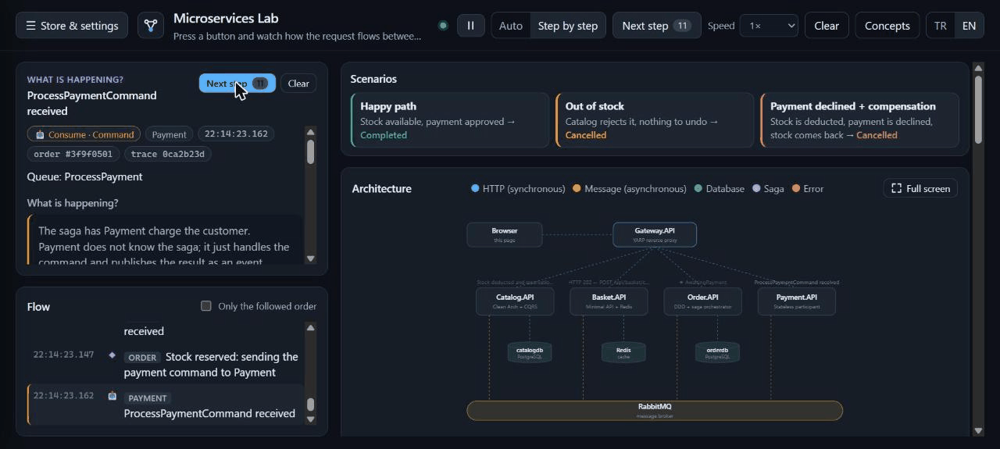

# Microservice E-Commerce (.NET 10)

[](https://github.com/CihanserC/Microservice-Ecommerce/actions/workflows/tests.yml)
[](https://cihanserc.github.io/Microservice-Ecommerce/)

A teaching-oriented microservices skeleton for an e-commerce domain. It demonstrates decoupling, synchronous and asynchronous communication, an API Gateway, an orchestrated saga with compensation, the transactional outbox and inbox, idempotent consumers, tracing and containerization.

It ships with an **interactive simulator**: a web UI that animates every HTTP call, message, database write and saga transition as it happens, and opens the exact line of code that produced it.



It is deliberately kept small so the ideas stay visible; it is not a production store. Authentication, resilience policies on synchronous calls (circuit breaker, retry, timeout), a saga timeout, Kubernetes and a tracing UI are left out on purpose. The docs list these limits and how to add them.

## Try it without installing anything

| | What runs | Needs |
|---|---|---|
| **[Live demo](https://cihanserc.github.io/Microservice-Ecommerce/)** | The simulator on GitHub Pages. The services are simulated in your browser with the same messages, saga, business rules and traces as the real system; the code viewer opens this repo's real source files. | Nothing |
| [](https://codespaces.new/CihanserC/Microservice-Ecommerce?quickstart=1) | The real system (all services, PostgreSQL, Redis, RabbitMQ) in a cloud dev container. The simulator opens by itself on port 5000 once the images are built (a few minutes the first time). | A GitHub account (Codespaces has a monthly free quota) |
| Locally | `docker compose up --build`, then http://localhost:5000 | Docker Desktop and git |

The demo is published by [`.github/workflows/pages.yml`](.github/workflows/pages.yml) on every push to `main`; the Codespaces setup is in [`.devcontainer/devcontainer.json`](.devcontainer/devcontainer.json). Add `?demo=1` to a running simulator's URL to compare the browser-simulated backend with the real one.

Lesson-style walkthroughs:

- [docs/architecture-overview.md](docs/architecture-overview.md): why the architecture is shaped this way.
- [docs/saga-and-simulator.md](docs/saga-and-simulator.md): the saga, compensation, outbox/idempotency, and how the simulator works.

## Architecture

```
  Browser ──► Gateway.API (YARP, :5000) ──► Simulator.Web (UI + live traces)
                    │
     ┌──────────────┼───────────────┬───────────────┐
     ▼              ▼               ▼               ▼
 Catalog.API    Basket.API      Order.API       Payment.API
 PostgreSQL       Redis         PostgreSQL      (stateless)
 stock owner                    saga orchestrator
     ▲              │               ▲ │             ▲
     └──────────────┴───── RabbitMQ ┴─┴─────────────┘
```

### Checkout saga

```
Basket ──BasketCheckoutEvent──► Order: order saved as Pending + OrderCreatedEvent (outbox)

OrderStateMachine
  Initial ──OrderCreated──► AwaitingStock ──StockReserved──► AwaitingPayment ──PaymentCompleted──► Completed
                                 │                                │
                     StockReservationFailed                 PaymentFailed
                                 ▼                                ▼
                             Cancelled ◄──StockReleased── Compensating (ReleaseStockCommand)
```

- **Catalog** reserves stock all-or-nothing (`ReserveStockCommand`) and releases it as compensation (`ReleaseStockCommand`).
- **Payment** succeeds or fails based on runtime-configurable rules (always succeed, always fail, fail above a card limit).
- **Order** hosts the MassTransit state machine. Saga state lives in `OrderSagaStates` next to the orders.
- Catalog and Order use the **EF Core transactional outbox and inbox**. Every participant is idempotent.

## Tech Stack

| Concern | Technology |
|---------|------------|
| Framework | .NET 10 / C# 14 |
| API Gateway | YARP |
| Async messaging | RabbitMQ + MassTransit 8 (Apache 2.0) |
| Saga | MassTransit state machine + EF Core repository |
| Reliable messaging | MassTransit EF Core transactional outbox / inbox |
| Relational data | PostgreSQL + EF Core 10 |
| Caching | Redis |
| Observability | OpenTelemetry + Serilog |
| Simulator | Server-Sent Events + dependency-free HTML/JS |
| Tests | xUnit + MassTransit test harness |
| Orchestration | Docker Compose |

## Solution Structure

```
src/
├── BuildingBlocks/
│   ├── Shared.Contracts/      # Integration events, saga commands/events, TraceEvent
│   └── Shared.Infrastructure/ # MassTransit, OpenTelemetry, Serilog, middleware, simulation tracing
├── Services/
│   ├── Catalog/               # CQRS + Clean Architecture, stock reservation consumers
│   ├── Basket/                # Minimal APIs + Redis
│   ├── Order/                 # DDD, checkout consumer, OrderStateMachine (saga)
│   └── Payment/               # Stateless payment simulator
├── ApiGateways/
│   └── Gateway.API/           # YARP reverse proxy
└── Web/
    └── Simulator.Web/         # Trace collector, SSE stream, source viewer, UI (wwwroot)
tests/
└── Order.Tests/               # Saga + domain tests (no broker or database needed)
```

## Quick Start (Docker)

```bash
docker compose up --build
```

Then open **http://localhost:5000** for the simulator.

| Service | URL |
|---------|-----|
| Simulator UI (via gateway) | http://localhost:5000 |
| Gateway | http://localhost:5000 |
| Catalog (direct) | http://localhost:5001 |
| Basket (direct) | http://localhost:5002 |
| Order (direct) | http://localhost:5003 |
| Payment (direct) | http://localhost:5004 |
| Simulator (direct) | http://localhost:5010 |
| RabbitMQ Management | http://localhost:15672 (guest/guest) |

Migrations run on startup, and Catalog seeds four products with stock levels chosen for the scenarios (plenty, low, zero).

## Using the simulator

- **Language**: the TR / EN switch in the top bar changes the whole UI instantly, including traces already on screen.
- **Scenarios**: one click fills the basket, picks the payment behavior and checks out.
  - *Happy path*: the order is `Completed`.
  - *Out of stock*: Catalog rejects the order and there is nothing to undo, so it is `Cancelled`.
  - *Payment declined + compensation*: stock is reserved, the payment is declined, stock is released, and the order is `Cancelled`.
- **Step mode**: plays one trace at a time (→ key). The "What is happening?" panel on the left explains the step in place and highlights the code line that emitted it; the page never scrolls.
- **Store & settings drawer** (☰): the catalog, basket and payment settings slide in from the left.
- **Full screen diagram**: the ⛶ button on the Architecture card (or the F key) shows the diagram full screen; step mode keeps its "Next step" button there.
- **Mobile**: the layout stacks on phones and the explanation becomes an always-visible bottom sheet.
- **Speed**: from 0.1× slow motion up to 4× or instant; a change applies immediately, even to a packet already in flight.
- **Pause / resume** (‖ / ▶ next to the mode switch, or the Space key) freezes the animation where it is.
- **Resizable panels** on desktop: drag the divider between the columns, or between "What is happening?" and the flow; double-click resets.
- **Concepts**: a searchable, bilingual library of microservice concepts (API Gateway, BFF, saga, outbox, circuit breaker, bulkhead, service discovery, strangler fig and more), each tied back to this codebase.
- **Click any box** in the diagram to see that component's responsibility and key files.
- **Catalog / basket / payment panels**: edit stock, build a basket by hand, and change the payment rules or bank delay.

Tracing is fire-and-forget: services enqueue traces in memory and a background publisher sends them to RabbitMQ, so a slow or missing broker never blocks requests. Set `Simulation__Enabled=false` to turn tracing off entirely.

## API Routes (via Gateway)

| Method | Gateway Path | Description |
|--------|--------------|-------------|
| GET | `/catalog` | List products (with stock) |
| GET | `/catalog/{id}` | Get product |
| POST | `/catalog` | Create product |
| PUT | `/catalog/{id}` | Update product (incl. stock) |
| GET | `/basket/{userName}` | Get basket |
| POST | `/basket` | Store basket |
| POST | `/basket/checkout` | Checkout (publishes event, starts the saga) |
| GET | `/orders` | List orders with status and saga state |
| GET | `/orders/{id}` | Get order with saga details |
| GET | `/payments` | Processed payments |
| GET/PUT | `/payments/settings` | Payment simulation rules |
| GET | `/sim/events` | Live trace stream (Server-Sent Events) |

All services expose `/health`.

## Example Flow (curl)

```bash
# 1. Add to basket (seeded product)
curl -X POST http://localhost:5000/basket \
  -H "Content-Type: application/json" \
  -d '{"userName":"john","items":[{"productId":"8a1c4f7e-0b1d-4c3a-9e57-1f0a2b3c4d01","productName":"Mekanik Klavye","quantity":1,"unitPrice":1899.90}]}'

# 2. Checkout
curl -X POST http://localhost:5000/basket/checkout \
  -H "Content-Type: application/json" \
  -d '{"userName":"john"}'

# 3. Watch the order move through the saga
curl http://localhost:5000/orders
```

## Tests

```bash
dotnet test
```

The saga tests run the state machine on MassTransit's in-memory test harness, so they need no RabbitMQ or PostgreSQL. They cover the happy path, a stock failure, a payment failure with compensation, and duplicate delivery.

## Local Development (without Docker)

1. Start infrastructure: PostgreSQL, Redis, RabbitMQ
2. Update connection strings in each service's `appsettings.json`
3. Run services:

```bash
dotnet run --project src/Services/Catalog/Catalog.API
dotnet run --project src/Services/Basket/Basket.API
dotnet run --project src/Services/Order/Order.API
dotnet run --project src/Services/Payment/Payment.API
dotnet run --project src/Web/Simulator.Web
dotnet run --project src/ApiGateways/Gateway.API
```

When run locally, `Simulator.Web` finds the source code by walking up to the `.slnx` file. In Docker, the source is copied into the image.

## License

See [LICENSE](LICENSE). MassTransit is pinned to 8.x (Apache 2.0); 9.x requires a commercial license.
