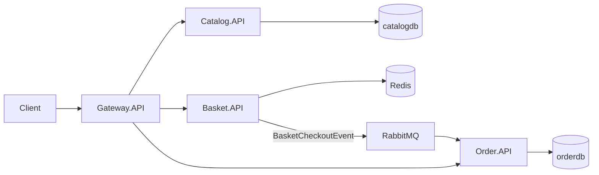

# How this e-commerce skeleton works

This text walks someone opening the repo for the first time through the architecture, like a lesson. The goal is not to list every file. The goal is to explain why the structure is shaped this way, how an order travels through the system, and where this skeleton deliberately stays simple.

Quick-start commands and the endpoint table are in the [README](../README.md). This document explains the "why".

## The picture in one sentence

The client enters through a single door: `Gateway.API`. The product catalog, the basket and the orders are three separate processes. Listing products and adding them to the basket are HTTP calls that need an immediate answer. Checkout, the payment step, does not call the order service over HTTP. The basket service publishes a `BasketCheckoutEvent`, RabbitMQ queues it, and the order service turns that message into an order in its own time.

The door lives in `src/ApiGateways/Gateway.API/Program.cs`. YARP runs as a reverse proxy: it forwards each incoming request to the right service and holds no business rules.

## Why three services?

Under the single word "e-commerce" there are three different lifetimes.

| Part | What it holds | How long it lives | Why it is separate |
| --- | --- | --- | --- |
| Catalog | Product name, description, price, image | As long as the product is on the shelf | Records are permanent and read often; relational rules are enough |
| Basket | A user's products that have not been bought yet | Until the user deletes the basket or checks out | Temporary, written often; losing it tomorrow breaks nothing |
| Order | A completed purchase | From the moment the order is created | The price and items at that moment must be preserved |

If these three were one process and one schema, the basket's temporary nature would tangle with the order's strict rules, and the catalog's CRUD would tangle with the order's immutability. The price of the split is that services cannot look at each other's tables. Data one service needs is either asked for over HTTP or copied into a message.

Docker Compose starts a single Postgres server. `scripts/init-databases.sql` creates two databases on it: `catalogdb` and `orderdb`. The server is shared; the data is not. Catalog only sees the `catalogdb` connection string, and Order only sees `orderdb`.

## Why isn't every service built the same way inside?

Being a microservice does not mean every folder tree is a copy of the others. The pattern is chosen to match the complexity inside each service.

### Catalog: use cases grow, so layers and MediatR

Catalog is split into four projects:

- `Catalog.Domain`: the `Product` entity. Its fields are public: name, description, price, image, stock, dates. There is no "you cannot create such a product" wall like the one in Order, because a catalog record is a plain CRUD record.
- `Catalog.Application`: intent. MediatR records such as `CreateProductCommand` and `GetProductsQuery` live here. This project knows nothing about EF Core. It only says "this should be done".
- `Catalog.Infrastructure`: where the work happens. `CreateProductHandler` writes to PostgreSQL through `CatalogDbContext`. The handlers live here so that database details stay out of Application. The saga consumers (`ReserveStockConsumer`, `ReleaseStockConsumer`) live here too.
- `Catalog.API`: HTTP. The Minimal API endpoint bodies contain no SQL. They call `ISender.Send(new CreateProductCommand(...))` and return `201 Created`.

The flow is: an HTTP request arrives, the endpoint builds a command or query object, MediatR finds the right handler, the handler saves, and an id comes back.

The reason for this split is growth. Listing products, getting one product, creating, updating and deleting are five use cases today. When work like "filter by price" or "low-stock alert" is added tomorrow, the HTTP file doesn't bloat. A new command folder and a handler are enough. `Program.cs` registers handlers from the assembly that contains `CreateProductHandler`, so every `IRequestHandler` in Infrastructure is found automatically.

`Product` has no private setters or factory method. The rule worth protecting in the catalog is a schema rule like "name is at most 200 characters", and that lives in the EF configuration inside `CatalogDbContext`. Strict behavior is left to Order.

### Basket: the work is thin, so one project and Redis

Basket has no Domain, Application or Infrastructure projects. Inside `Basket.API`, models, `BasketService` and the endpoints sit side by side.

A basket is a user's temporary list. It needs no relations, transactions or migrations. It is written and deleted often. Redis fits that: `BasketService` serializes the basket to JSON and stores it in `IDistributedCache` under the key `basket:{userName}`. PostgreSQL would be both slower here and carry a schema for nothing.

Checkout is this service's only "heavy" moment. The endpoint reads the basket from Redis and returns `400` if it is empty. Otherwise it builds a `BasketCheckoutEvent`, publishes it with MassTransit's `IPublishEndpoint`, deletes the basket and returns `202 Accepted`. `202` is chosen on purpose: it doesn't say "the order was created", it says "checkout has started". Writing the order is another process's job.

A single project is not a shortcoming here. Four projects would just produce empty folders for a basket that contains one service class.

### Order: rules matter, so DDD

The order is not modeled as "a table with a few columns". Two rules live inside the domain and cannot be bypassed from outside:

- `CustomerOrder.Create` rejects an empty item list. An order has at least one item.
- `OrderItem.Create` throws if the quantity is zero or negative.

`Money` is a separate value object. Addition and multiplication are defined on it. There is no total price column; `TotalPrice` is computed from the items' `LineTotal` values. That way "the line totals don't match the order total" can never happen.

EF Core maps this model to tables like this (`CustomerOrderConfiguration`):

- `CustomerOrder` → the `Orders` table.
- Items go to the `OrderItems` table with `OwnsMany`. An item is not an aggregate that travels independently of the order; the order owns it.
- `Money` is embedded in the `OrderItems.UnitPrice` column with `OwnsOne`. No separate table is created for money.
- `LineTotal` and `TotalPrice` are `Ignore`d. Computed values are not written to columns.
- The field behind the `Items` list is marked as `_items`. Nobody can `Add` to the list from outside; the way to add items is the `Create` factory. EF writes to the private field when reading.

That's why the HTTP side only reads. `OrderEndpoints` offers `GET /api/orders` and `GET /api/orders/{id}`. There is no write endpoint. The only legitimate source of an order is `BasketCheckoutConsumer`: it builds `OrderItem` and `CustomerOrder` from the message's items and saves them to `orderdb`.

Catalog has MediatR; Order does not. Reading is just two queries and ends inside the endpoint with an `AsNoTracking` projection. Writing happens in one consumer. Adding a command/query layer here would only give the same work a second name.

## Why are some calls HTTP while checkout uses a queue?

The two communication styles answer two different expectations.

Work that needs an immediate answer is synchronous: "list products", "give me this user's basket", "show the orders". The client wants to see the result in that HTTP response. These calls go through the gateway to the relevant service.

Checkout is asynchronous, because if the basket service called the order service over HTTP directly, each service would depend on the other being up. If Order were down for a moment, checkout would fail too. With a queue, Basket leaves the message and finishes its own work. When Order comes up, it consumes the message.

The message's shape is the `BasketCheckoutEvent` record in `Shared.Contracts`: user name, total and a list of items. Each item has a product id, name, quantity and unit price. At checkout, the basket does not ask the catalog service again; the name and price are copied into the message. The reasoning: an order is the commercial agreement at that moment. Even if the catalog price changes five minutes later, the existing order keeps the old price.

The result of this copying is that there is no runtime link between Catalog and Order. The only link is the data inside the event.

## Building blocks: repeated infrastructure lives in one place

Services don't share each other's domain. There are two shared projects, and both have a narrow job.

### Shared.Contracts

It contains no entities, DbContexts or HTTP. Only integration contracts:

- `BasketCheckoutEvent` and `BasketCheckoutItem`: the message the basket leaves for the order.
- `OrderCreatedEvent`: published when an order is saved; it starts the saga. The saga's commands and events are in the `Saga/` folder.
- `TraceEvent`: the simulator's trace record (see [the saga document](saga-and-simulator.md)).

Contracts are `record`s. The `Product` and `CustomerOrder` classes are not placed here. If they were, every service would be bound to the others' table shapes, and adding a field in one would break another. A message carries the fields needed at that moment and nothing more.

### Shared.Infrastructure

The setup every process needs lives here. Every `Program.cs` calls the same extensions:

- `UseSharedSerilog("Catalog.API")`: writes `ServiceName` to the console log, so when several containers log at once you can tell which service a line came from.
- `AddSharedOpenTelemetry`: collects traces from ASP.NET Core, the HTTP client and MassTransit and prints them to the console.
- `UseSharedInfrastructure`: `ExceptionHandlingMiddleware`, which turns unhandled errors into JSON.
- `AddSharedMassTransit`: reads the RabbitMQ host, user and password from configuration and sets up the shared retry policy. A service with consumers registers them through `configureConsumers`. Basket only publishes, so it registers no consumer; Order registers `BasketCheckoutConsumer` and the saga. MassTransit derives queue names from the consumer types.
- `AddSimulationTracing`: the simulator's tracing (see [the saga document](saga-and-simulator.md)).

Without these extensions, the Serilog template, the RabbitMQ host setup and the error response would be copied into every `Program.cs`. This is where shared code draws the line: infrastructure goes in, business rules don't.

## Why does the gateway exist, and why does the path change?

The client doesn't have to know `localhost:5001`, `5002` and `5003`. The single address is the gateway on `localhost:5000`. The services' internal routes (`/api/products`) and the names exposed to the outside (`/catalog`) differ on purpose.

The YARP rule in `appsettings.json` roughly says: send `/catalog` and `/catalog/...` requests to the catalog cluster and rewrite the path to `/api/products/...`. The same transformation exists for `/basket` → `/api/basket`, `/orders` → `/api/orders` and `/payments` → `/api/payments`. The `/sim` routes and every other path go to the simulator.

Addresses change per environment. Locally the cluster targets are ports such as `http://localhost:5001`. In Docker, `appsettings.Docker.json` turns the targets into service names: `http://catalog.api:8080`. The application inside the container listens on 8080 and is published to the outside as 5001. Inside the Docker network the gateway goes to its sibling container's name, not to the host port.

Every service has a health check at `/health`. Catalog and Order check Postgres, and Basket checks Redis. Compose only starts the API containers after the `postgres` / `redis` / `rabbitmq` health checks pass.

## The story of an order

The steps below follow the same order as the curl example in the README. Addresses go through the gateway.

1. **A product exists.** `POST /catalog` becomes `/api/products` at the gateway. The catalog endpoint sends `CreateProductCommand`. The handler writes a `Product` to the `catalogdb.Products` table and returns a `Guid`. (Catalog also seeds four products on startup.)
2. **The basket fills up.** The `POST /basket` body contains the user name and the items. `BasketService` writes it to Redis under the key `basket:john`. Catalog is not asked at this step. The client sends the product id, name and price itself.
3. **Checkout starts.** `POST /basket/checkout` only needs the user name. The service reads the basket, publishes `BasketCheckoutEvent`, deletes the Redis key and returns `202`. This response does not mean "the order record was written".
4. **The queue is processed.** The Order service receives the message with `BasketCheckoutConsumer`. Each item is built with `OrderItem.Create` and the order with `CustomerOrder.Create`. The record goes to the `Orders` and `OrderItems` tables in `orderdb` as `Pending`, together with an `OrderCreatedEvent` in the outbox.
5. **The order is read.** `GET /orders` lands on Order's list endpoint through the gateway. The total is computed on the spot from each item's unit price times its quantity.

The order list may be empty right after checkout. The message hasn't been consumed yet. A few hundred milliseconds later the same request shows the record. This delay is the natural consequence of choosing a queue.

## Limits left on purpose

This repo is not a complete production store. It is a skeleton simplified for teaching. The following are not in the code; don't read it as if they were.

- **Basket has no outbox.** At checkout, publishing and deleting the basket are separate steps. If the process crashes after the message is written to RabbitMQ, the basket may not be deleted. The reverse is also possible: if something breaks between publishing and deleting, the basket may be gone while the order was never created. Basket's database is Redis, so the outbox is not used here. Catalog and Order do use the transactional outbox; the details are in [the saga document](saga-and-simulator.md).
- **There is no authentication.** A basket is found by its `userName` string. Anyone can read another user's basket. This is because neither JWT nor Identity has been added.
- **Checkout doesn't validate the catalog price.** The `unitPrice` the client writes into the basket goes into the order as is.

These gaps don't mean the architecture is "wrong". The skeleton exists to show the door, the data split, synchronous reads and asynchronous checkout. Authentication is the next lesson to build on top of these ideas.

## Next lesson: the saga

The story above ends where the order is written as `Pending`. What comes next, reserving stock, taking payment, and releasing the stock when payment is declined, is in [Saga, compensation and the simulator](saga-and-simulator.md). You can follow the same flow step by step in the simulator at `http://localhost:5000`.
