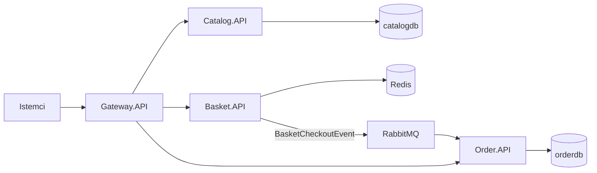

# Bu e-ticaret iskeleti nasıl çalışır?

Bu metin, repoyu ilk kez açan birine mimariyi ders gibi anlatır. Amaç her dosyayı dökmek değildir. Amaç şudur: bu yapı neden böyle kurulmuş, bir sipariş sistemin içinde nasıl yürür, ve bu iskeletin bilerek basit bıraktığı yerler neresidir.

Kısa başlangıç komutları ve endpoint tablosu [README](../README.md) içindedir. Burada “neden” anlatılır.

## Tek cümlelik resim

İstemci tek bir kapıdan girer: `Gateway.API`. Ürün kataloğu, sepet ve sipariş üç ayrı süreçtir. Ürünü listelemek ve sepete koymak anında cevap isteyen HTTP çağrılarıdır. Ödeme adımı olan checkout ise HTTP ile sipariş servisini çağırmaz. Sepet servisi bir `BasketCheckoutEvent` yayınlar, RabbitMQ kuyruğa alır, sipariş servisi o mesajı kendi zamanında siparişe çevirir.

Kapı `src/ApiGateways/Gateway.API/Program.cs` içindedir. YARP ters vekil olarak çalışır: gelen isteği doğru servise iletir, iş kuralı barındırmaz.

## Neden üç servis?

Aynı “e-ticaret” kelimesinin altında üç farklı ömür vardır.

| Parça | Ne tutar | Ne kadar yaşar | Neden ayrı |
| --- | --- | --- | --- |
| Catalog | Ürün adı, açıklama, fiyat, görsel | Ürün raflarda durduğu sürece | Kayıt kalıcıdır, sık okunur, ilişkisel kurallar yeterlidir |
| Basket | Bir kullanıcının henüz alınmamış ürünleri | Kullanıcı sepeti silene veya checkout edene kadar | Geçicidir, çok yazılır, yarın silinse iş bozulmaz |
| Order | Gerçekleşmiş satın alma | Sipariş oluştuktan sonra | Oluştuğu andaki fiyat ve kalemler korunmalıdır |

Bu üçü tek süreç ve tek şema olsaydı, sepetin geçici doğası siparişin katı kurallarına, kataloğun CRUD’ü de siparişin değişmezliğine karışırdı. Ayrımın bedeli şudur: servisler birbirinin tablosuna bakamaz. Birinin ihtiyacı olan veri, ya HTTP ile sorulur ya da mesajın içine kopyalanır.

Docker Compose aynı Postgres sunucusunu açar. `scripts/init-databases.sql` bu sunucuda iki veritabanı oluşturur: `catalogdb` ve `orderdb`. Sunucu ortaktır, veri alanı ayrıdır. Catalog yalnızca `catalogdb` bağlantı dizesini, Order yalnızca `orderdb` bağlantı dizesini görür.

## Neden her servisin içi aynı kalıpta değil?

Mikroservis olmak, her klasör ağacının birbirinin kopyası olması demek değildir. Kalıp, o servisteki karmaşıklığa göre seçilmiştir.

### Catalog: use case’ler büyür, o yüzden katman ve MediatR

Catalog dört projeye bölünmüştür:

- `Catalog.Domain` — `Product` varlığı. Alanları açıktır: ad, açıklama, fiyat, görsel, tarihler. Siparişteki gibi “böyle bir ürün oluşturulamaz” duvarı burada yoktur, çünkü katalog kaydı sade bir CRUD kaydıdır.
- `Catalog.Application` — niyet. `CreateProductCommand`, `GetProductsQuery` gibi MediatR kayıtları burada durur. Bu proje EF Core bilmez. Yalnızca “şu iş yapılsın” der.
- `Catalog.Infrastructure` — işin yapıldığı yer. `CreateProductHandler` `CatalogDbContext` ile PostgreSQL’e yazar. Handler’lar burada durur, çünkü veritabanı detayı Application’a sızmasın diye EF bu katmanda tutulur.
- `Catalog.API` — HTTP. Minimal API endpoint’i gövdesinde SQL yoktur. `ISender.Send(new CreateProductCommand(...))` çağırır ve `201 Created` döner.

Akış şöyledir: HTTP isteği gelir, endpoint bir komut veya sorgu nesnesi üretir, MediatR doğru handler’ı bulur, handler kaydeder, kimlik geri döner.

Bu ayrımın gerekçesi büyümedir. Ürün listeleme, tek ürün, oluşturma, güncelleme ve silme bugün beş use case’dir. Yarın “fiyata göre filtrele”, “stok uyarısı” gibi işler eklendiğinde HTTP dosyası şişmez. Yeni bir komut klasörü ve bir handler yeterli olur. `Program.cs` handler’ları `CreateProductHandler`ın assembly’sinden kaydeder, yani Infrastructure’daki her `IRequestHandler` otomatik bulunur.

`Product` üzerinde private setter ve fabrika metodu yoktur. Katalogda korunacak iş kuralı “ad en fazla 200 karakter” gibi şema kuralıdır; o da `CatalogDbContext` içindeki EF yapılandırmasında durur. Katı davranış Order’a bırakılmıştır.

### Basket: iş ince, o yüzden tek proje ve Redis

Basket’te Domain, Application ve Infrastructure projeleri yoktur. `Basket.API` içinde modeller, `BasketService` ve endpoint’ler yan yanadır.

Sepet bir kullanıcının geçici listesidir. İlişki, transaction, migration istemez. Sık yazılır ve silinir. Redis buna uyar: `BasketService` sepeti JSON yapar ve `basket:{userName}` anahtarıyla `IDistributedCache` içine koyar. PostgreSQL burada hem yavaş kalır hem de boşuna şema taşır.

Checkout bu servisin tek “ağır” anıdır. Endpoint sepeti Redis’ten okur, boşsa `400` döner. Doluysa `BasketCheckoutEvent` üretir, MassTransit `IPublishEndpoint` ile yayınlar, sepeti siler ve `202 Accepted` döner. `202` bilerek seçilmiştir: “sipariş oluştu” demez, “checkout başlatıldı” der. Siparişin yazılması başka sürecin işidir.

Tek proje burada bir eksiklik değildir. Dört proje açmak, içinde yalnızca bir servis sınıfı olan bir sepet için boş klasör üretirdi.

### Order: kurallar önemli, o yüzden DDD

Sipariş “birkaç kolonlu tablo” olarak modellenmemiştir. İki kural domain’in içindedir ve dışarıdan atlanamaz:

- `CustomerOrder.Create` boş kalem listesini reddeder. Siparişin en az bir kalemi vardır.
- `OrderItem.Create` miktar sıfır veya negatifse fırlatır.

`Money` ayrı bir değer nesnesidir. Toplama ve çarpma onun üzerinde tanımlıdır. Toplam fiyat kolonu yoktur; `TotalPrice`, kalemlerin `LineTotal` değerlerinden hesaplanır. Böylece “satır toplamı ile sipariş toplamı uyuşmuyor” durumu oluşmaz.

EF Core bu modeli tabloya şöyle yatırır (`CustomerOrderConfiguration`):

- `CustomerOrder` → `Orders` tablosu.
- Kalemler `OwnsMany` ile `OrderItems` tablosuna gider. Kalem, siparişten bağımsız dolaşan bir aggregate değildir; sahibi sipariştir.
- `Money`, `OwnsOne` ile `OrderItems.UnitPrice` kolonuna gömülür. Para için ayrı tablo açılmaz.
- `LineTotal` ve `TotalPrice` `Ignore` edilir. Hesaplanan değerler kolona yazılmaz.
- `Items` listesinin alanı `_items` olarak işaretlenir. Dışarıdan listeye `Add` yapılamaz; kalem eklemenin yolu `Create` fabrikasıdır. EF okurken private alana yazar.

HTTP tarafı bu yüzden yalnızca okur. `OrderEndpoints` `GET /api/orders` ve `GET /api/orders/{id}` sunar. Yazma ucu yoktur. Siparişin tek meşru kaynağı `BasketCheckoutConsumer`dır: mesajdaki kalemlerden `OrderItem` ve `CustomerOrder` üretir, `orderdb`ye kaydeder.

Catalog’da MediatR vardır, Order’da yoktur. Okuma iki sorgudan ibarettir ve endpoint içinde `AsNoTracking` projeksiyonla biter. Yazma tek bir consumer’dadır. Buraya komut/sorgu katmanı eklemek aynı işi ikinci kez isimlendirmek olurdu.

## Neden bazı çağrılar HTTP, checkout ise kuyruk?

İki iletişim biçimi iki farklı beklentiye karşılık gelir.

Anında cevap gereken işler senkrondur. “Ürünleri listele”, “şu kullanıcının sepetini ver”, “siparişleri göster”. İstemci sonucu o HTTP cevabında görmek ister. Bu çağrılar gateway üzerinden ilgili servise gider.

Checkout asenkrondur, çünkü sepet servisinin sipariş servisine doğrudan HTTP atması iki servisi birbirinin ayakta olma haline bağlar. Order bir an kapalıysa checkout da başarısız olur. Kuyrukta ise Basket mesajı bırakır ve kendi işini bitirir. Order ayağa kalktığında mesajı tüketir.

Mesajın şekli `Shared.Contracts` içindeki `BasketCheckoutEvent` kaydıdır: kullanıcı adı, toplam, kalem listesi. Her kalemde ürün kimliği, adı, miktarı ve birim fiyatı vardır. Sepet, checkout anında katalog servisine tekrar sormaz. Ad ve fiyat mesaja kopyalanır. Gerekçe şudur: sipariş, o andaki ticari anlaşmadır. Katalog fiyatı beş dakika sonra değişse bile oluşmuş sipariş eski fiyatı taşır.

Bu kopyalamanın sonucu şudur: Catalog ile Order arasında çalışma anında bir bağ yoktur. Bağ, yalnızca olayın içindeki veridir.

## Building blocks: tekrar eden altyapı bir yerde toplanır

Servisler birbirinin domain’ini paylaşmaz. Paylaştıkları iki proje vardır ve ikisinin de görevi dardır.

### Shared.Contracts

İçinde entity, DbContext veya HTTP yoktur. Yalnızca entegrasyon sözleşmeleri vardır:

- `BasketCheckoutEvent` ve `BasketCheckoutItem` — sepetin siparişe bıraktığı mesaj.
- `OrderCreatedEvent` — sipariş kaydedilince yayınlanır ve saga’yı başlatır. Saga’nın komut ve olayları `Saga/` klasöründedir.

Sözleşme `record`dur. `Product` veya `CustomerOrder` sınıfları buraya konmamıştır. Konulsaydı her servis diğerinin tablo şekline bağlanır, biri alan eklediğinde diğeri kırılırdı. Mesaj, o an gereken alanları taşır; gerisini taşımaz.

### Shared.Infrastructure

Dört sürecin hepsinin ihtiyaç duyduğu kurulum buradadır. Her `Program.cs` aynı uzantıları çağırır:

- `UseSharedSerilog("Catalog.API")` — konsol loguna `ServiceName` yazar. Dört konteyner aynı anda log basarken satırın hangi servisten geldiği okunur.
- `AddSharedOpenTelemetry` — ASP.NET Core, HTTP istemcisi ve MassTransit kaynaklarından trace toplar, konsola basar.
- `UseSharedInfrastructure` — yakalanmamış hatayı JSON’a çeviren `ExceptionHandlingMiddleware`.
- `AddSharedMassTransit` — RabbitMQ host, kullanıcı ve şifreyi yapılandırmadan okur. Consumer’ı olan servis, `configureConsumers` ile kendini kaydeder. Basket yalnızca yayınlar, o yüzden consumer kaydetmez. Order `BasketCheckoutConsumer`ı kaydeder. MassTransit kuyruk adını consumer tipinden üretir.

Bu uzantılar olmasaydı Serilog şablonu, RabbitMQ host kurulumu ve hata cevabı dört `Program.cs` içinde kopyalanırdı. Ortak kodun sınırı burasıdır: iş kuralı girmez, altyapı girer.

## Gateway neden var, path neden değişiyor?

İstemci `localhost:5001`, `5002` ve `5003` bilmek zorunda değildir. Tek adres `localhost:5000` üzerindeki gateway’dir. Servislerin iç route’ları (`/api/products`) ile dışarıya açılan isimler (`/catalog`) bilinçli olarak farklıdır.

`appsettings.json` içindeki YARP kuralı kabaca şunu der: `/catalog` ve `/catalog/...` isteklerini catalog kümesine yolla, yolu `/api/products/...` olacak şekilde yeniden yaz. Aynı dönüşüm `/basket` → `/api/basket` ve `/orders` → `/api/orders` için de vardır.

Adresler ortama göre değişir. Yerelde küme hedefi `http://localhost:5001` gibi portlardır. Docker’da `appsettings.Docker.json` hedefleri servis adına çevirir: `http://catalog.api:8080`. Konteyner içindeki uygulama 8080 dinler; dışarıya 5001 olarak yayınlanır. Gateway Docker ağında kardeş konteynerin adına gider, host portuna gitmez.

Health check her serviste `/health` altındadır. Catalog ve Order Postgres’e, Basket Redis’e bakar. Compose, API konteynerini ancak `postgres` / `redis` / `rabbitmq` health check’i geçtikten sonra kaldırır.

## Bir siparişin hikâyesi

Aşağıdaki adımlar README’deki curl örneğiyle aynı sırayı izler. Adresler gateway üzerindendir.

1. **Ürün oluşur.** `POST /catalog` gövdesi gateway’de `/api/products` olur. Catalog endpoint’i `CreateProductCommand` gönderir. Handler `catalogdb.Products` tablosuna bir `Product` yazar ve `Guid` döner.
2. **Sepet dolar.** `POST /basket` gövdesinde kullanıcı adı ve kalemler vardır. `BasketService` bunu `basket:john` anahtarıyla Redis’e yazar. Bu adımda Catalog’a sorulmaz. İstemci ürün kimliğini, adını ve fiyatını kendisi gönderir.
3. **Checkout başlar.** `POST /basket/checkout` yalnızca kullanıcı adı ister. Servis sepeti okur, `BasketCheckoutEvent` yayınlar, Redis anahtarını siler, `202` döner. Bu cevap “sipariş kaydı yazıldı” anlamına gelmez.
4. **Kuyruk işlenir.** Order servisi `BasketCheckoutConsumer` ile mesajı alır. Her kalem `OrderItem.Create` ile, sipariş `CustomerOrder.Create` ile kurulur. Kayıt `orderdb` içindeki `Orders` ve `OrderItems` tablolarına gider.
5. **Sipariş okunur.** `GET /orders` gateway üzerinden Order’ın liste ucuna düşer. Toplam, kalemlerin birim fiyatı ile miktarının çarpımından o anda hesaplanır.

Sipariş listesi checkout’tan hemen sonra boş gelebilir. Mesaj henüz tüketilmemiştir. Birkaç yüz milisaniye sonra aynı istek kaydı gösterir. Bu gecikme, kuyruğu seçmenin doğal sonucudur.

## Bilerek bırakılmış sınırlar

Bu repo üretimdeki bir mağazanın tamamı değildir. Öğretmek için sadeleştirilmiş bir iskelettir. Aşağıdakiler kodda yoktur; varmış gibi okunmamalıdır.

- **Basket’te outbox yoktur.** Checkout’ta yayınlama ve sepeti silme ayrı adımlardır. Mesaj RabbitMQ’ya yazıldıktan sonra süreç çökerse sepet silinmemiş kalabilir. Tersi de tanınmıştır: yayınlama ile silme arasında bir kopma olursa sepet gitmiş, sipariş hiç oluşmamış olabilir. Basket’in veritabanı Redis olduğu için outbox burada kullanılmaz. Catalog ve Order ise transactional outbox kullanır; ayrıntısı [saga anlatımındadır](saga-ve-simulator.md).
- **Kimlik doğrulama yoktur.** Sepet `userName` dizesiyle bulunur. İsteyen başka bir kullanıcının sepetini okuyabilir. Bu, JWT veya Identity eklenmediği için böyledir.
- **Checkout katalog fiyatını doğrulamaz.** İstemcinin sepete yazdığı `unitPrice`, siparişe aynen geçer.

Bu boşluklar mimarinin “yanlış” olduğu anlamına gelmez. İskelet, kapı, veri ayrımı, senkron okuma ve asenkron checkout’u göstermek için durur. Kimlik doğrulama bu fikirlerin üzerine eklenecek sonraki derstir.

## Sonraki ders: saga

Yukarıdaki hikâye siparişin `Pending` olarak yazıldığı yerde biter. Bundan sonrası, yani stok ayırma, ödeme ve ödeme reddedilince stoğun geri bırakılması, [Saga, telafi ve simülatör](saga-ve-simulator.md) dokümanındadır. Aynı akışı `http://localhost:5000` adresindeki simülatörde adım adım izleyebilirsin.
