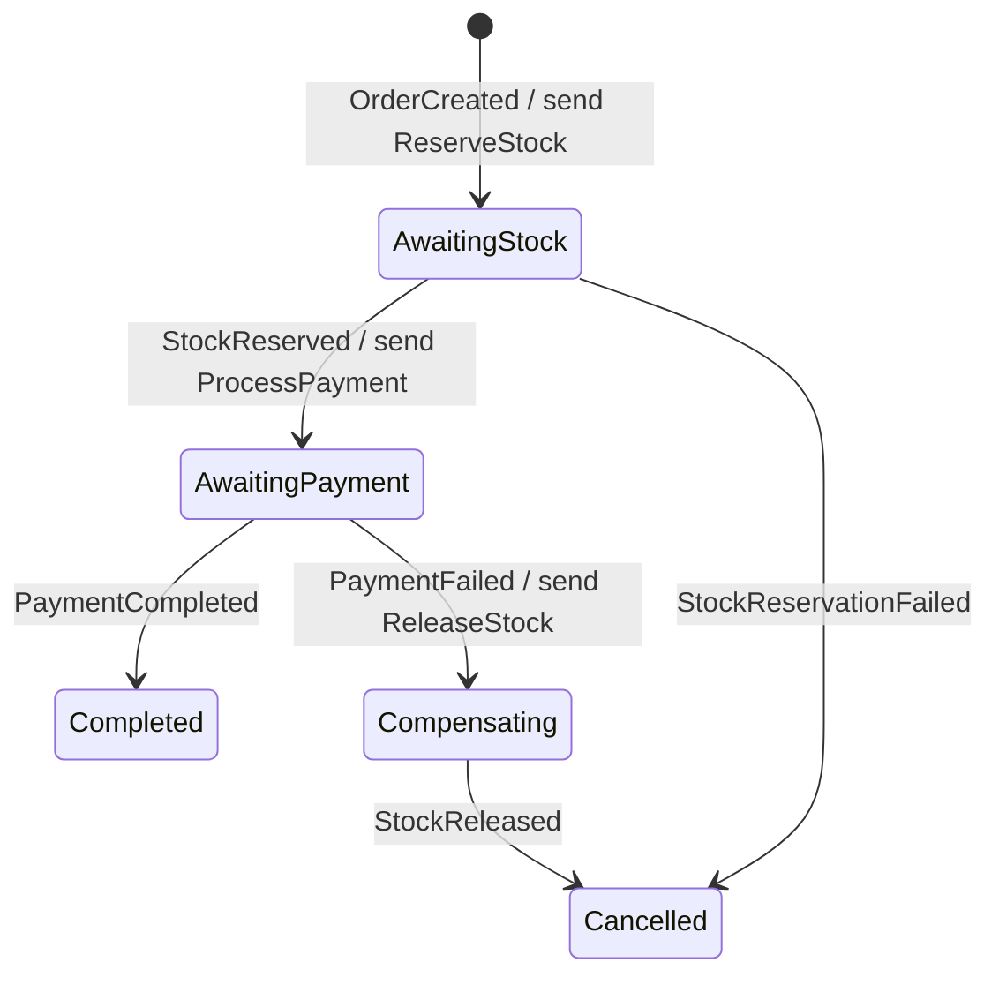
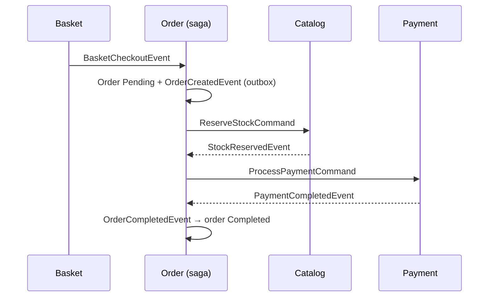
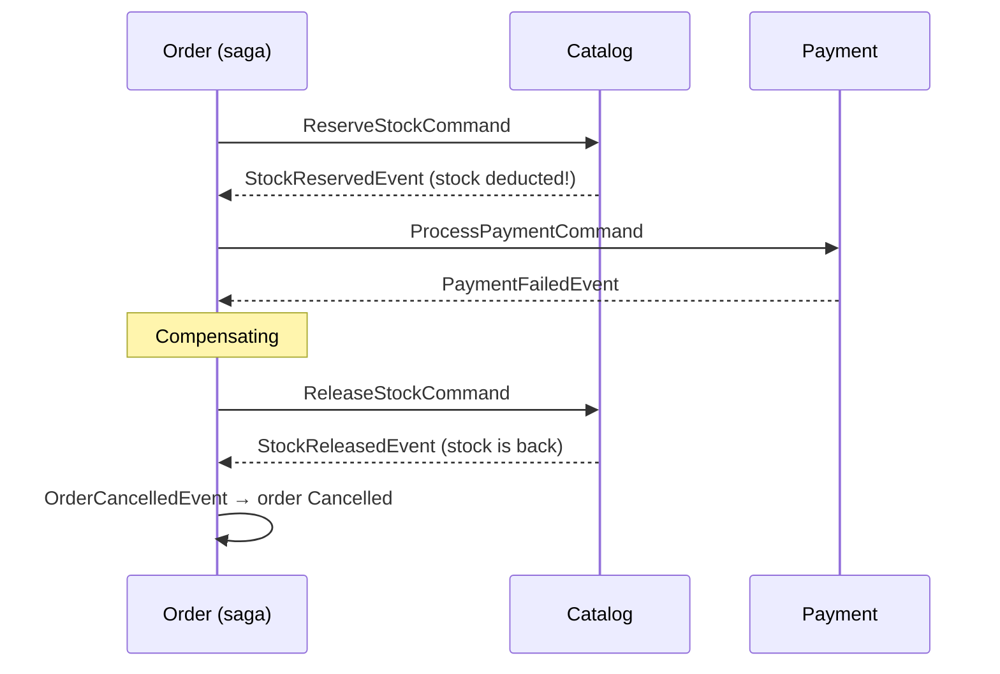
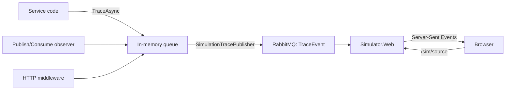

# Saga, compensation and the simulator

This text continues the [architecture overview](architecture-overview.md). There we saw checkout being handed to a queue and the order being created in the background. Here we cover how that order goes through the stock and payment steps, what gets undone (and how) when a step fails, and how all of it is observed in the simulator.

## The problem: work that doesn't fit in one transaction

Two things must happen for an order to be completed:

1. Stock must be deducted in Catalog (`catalogdb`).
2. Payment must be taken in Payment.

In a monolith this is a single database transaction: if one fails, `ROLLBACK` undoes both. In microservices each service has its own database. There is no shared transaction that could undo the stock deduction Catalog committed because of an error in Payment.

A saga fills that gap: it splits the work into steps that are each a local transaction in their own service. If a step fails, it runs new steps that **compensate** for the steps that already succeeded.

## The saga in this repo: orchestration

One place makes the decisions: `Order.Infrastructure/Saga/OrderStateMachine.cs`. MassTransit's state machine keeps one row per order in the `OrderSagaStates` table. That row is the saga's memory: when a message arrives, the saga continues where it left off.



| State | Waiting for | Exit |
| --- | --- | --- |
| `AwaitingStock` | Catalog's stock reply | `StockReserved` → move to payment; `StockReservationFailed` → cancel |
| `AwaitingPayment` | Payment's result | `PaymentCompleted` → done; `PaymentFailed` → compensate |
| `Compensating` | The stock being released | `StockReleased` → cancel |
| `Completed` / `Cancelled` | — | Final states. The row isn't deleted, so the simulator and `GET /orders` can show the outcome. |

### Happy path



### Payment declined and compensation



Compensation is not a "rollback". The stock deduction was committed, and another order may have seen that product in the meantime. Compensation is a **new** operation that reverses the earlier one. That's why compensating steps must also be designed, tested and idempotent.

If stock is insufficient, no compensation is needed. Catalog works all-or-nothing: if even one item is short, it reserves none of them. With no successful step to undo, the saga goes straight to `Cancelled`.

### Why orchestration and not choreography?

In choreography there is no center: Catalog listens for `OrderCreatedEvent` and reserves stock, Payment listens for `StockReservedEvent` and charges, and so on. For small flows this means less code. But the process as a whole isn't written in any file; the answer to "what happens when payment is declined?" is scattered across services.

This repo exists to teach. The whole process sits in one file as a readable state machine. The participants (Catalog, Payment) are unaware of the saga: they receive a command and publish an event. The same Payment service could be reused unchanged tomorrow in a subscription-renewal saga.

If you want to try choreography, here is a good exercise: turn off `OrderStateMachine`; add an `OrderCreatedEvent` consumer to Catalog and a `StockReservedEvent` consumer to Payment, and do the compensation by having Catalog listen for `PaymentFailedEvent`. Compare the two flows in the simulator.

## Reliable messaging: outbox, inbox, idempotency

A saga only works if messages aren't lost and do no harm when they arrive twice.

**Transactional outbox.** `BasketCheckoutConsumer` saves the order and publishes `OrderCreatedEvent`. These are two separate systems (PostgreSQL and RabbitMQ). If the process crashes in between, you get "the order exists but the saga never started". With the outbox on, `Publish` doesn't write the message to RabbitMQ; it writes it to the `OutboxMessage` table inside the same transaction. MassTransit delivers it after the commit. That's why Catalog and Order use `AddEntityFrameworkOutbox` (see the `DependencyInjection.cs` files).

**Inbox.** RabbitMQ delivers "at least once". The `InboxState` table stops the same consumer from processing the same message id twice.

**Business-level idempotency.** For repeats that have a different message id but the same meaning, each participant takes its own precautions:

| Participant | If it arrives again | How |
| --- | --- | --- |
| `ReserveStockConsumer` | Stock isn't deducted twice | If the order already has rows in `StockReservations`, it republishes the result |
| `ReleaseStockConsumer` | Stock isn't increased twice | If the reservation rows are already gone, it only publishes the event |
| `ProcessPaymentConsumer` | It doesn't charge twice | It returns the first record for the same order |
| `OrderStateMachine` | It doesn't fail | `OnUnhandledEvent(x => x.Ignore())` |
| `CustomerOrder` | Its state isn't corrupted | `Complete()` / `Cancel()` stay quiet on a second transition to the same state |

**Concurrency.** If two orders try to reserve the last item at the same time, `Product.Version` (PostgreSQL `xmin`) acts as an optimistic lock. The second write gets a `DbUpdateConcurrencyException`, `UseMessageRetry` retries the message, and on the second attempt the stock is now insufficient. The saga row, on the other hand, takes a row lock with `ConcurrencyMode.Pessimistic`.

**Correlation.** Every saga message carries `OrderId`. `Event(() => StockReserved, x => x.CorrelateById(m => m.Message.OrderId))` says which saga row to update.

## How does the simulator work?

The simulator is not part of the business flow. Services separately publish "here's what I just did", and the simulator collects these and pushes them to the browser.



The pieces are under `Shared.Infrastructure/Simulation`:

- **`ISimulationTracer`** is the only interface business code uses. Thanks to `[CallerFilePath]` and `[CallerLineNumber]`, every trace carries the line that produced it, which is what opens the "Line that emitted the trace" tab in the UI.
- **`TraceText`** holds a trace's title and detail in both Turkish and English. Each trace carries both languages, so the UI can switch language instantly without asking the services again. A plain `string` converts to `TraceText` implicitly and is used for text that is the same in both languages (such as `HTTP GET /api/products`).
- **Observers** (`SimulationMessageObservers.cs`) produce a trace automatically for every publish and consume. All message traffic becomes visible without touching business code.
- **HTTP middleware** (`SimulationHttpTraceMiddleware.cs`) produces two traces per request: when it arrives and when the response goes back. Requests the UI makes to refresh its lists carry the `X-Simulator-Background` header and aren't traced. Otherwise every refresh would produce a new trace, and every trace a new refresh.
- **Queue and publisher** (`SimulationTracer.cs`): `TraceAsync` drops the trace into a bounded in-memory queue and returns immediately. The background `SimulationTracePublisher` publishes traces in order, each with a 3-second timeout. Even when RabbitMQ is slow or down, HTTP requests and consumers don't wait; at worst a trace is lost.
- **`Simulator.Web`** reads `TraceEvent`s from a temporary (auto-delete) queue, keeps the last 1000 traces in memory and streams them over `/sim/events` as Server-Sent Events. `/sim/source` returns a source file from the repo; only text files under `src/` are allowed.

The `Simulation:Enabled=false` setting turns tracing off entirely. The services work exactly the same without the simulator.

### The interface

`http://localhost:5000` opens the simulator through the gateway.

On a computer the page always fits the screen and never scrolls: the left column holds the **"What is happening?"** panel and the **Flow** list, the right column holds the scenarios, the diagram, the saga and the orders. The catalog, basket and payment settings live in the **Store & settings** drawer that slides in from the left (☰). On a phone the page scrolls normally and "What is happening?" becomes a bottom sheet that is always on screen, with its own "Next step" button.

- **Scenarios** fill the basket, pick the payment behavior and check out. The "Payment declined + compensation" scenario shows the 4K Monitor's stock first going down and then coming back.
- **Step mode** plays each trace one at a time (→ key). The detail panel shows the step's explanation, the message body and the relevant line of code.
- **Speed** goes from 0.1× (slow motion) up to 4× or instant. Packets in the diagram move at the same constant speed on every line, so a long hop along the RabbitMQ bus simply takes longer than a short hop to a database. The simulator never speeds up on its own to catch up with a backlog; queued traces are played in order at the chosen speed (use "Instant" or "Clear" to skip ahead).
- **Language**: the TR / EN switch in the top bar changes every text on the page instantly, including the traces already in the flow and the open detail panel. The choice is remembered in the browser.
- **Full screen**: the button on the Architecture card (or the F key) shows the diagram full screen; Esc or F returns. In step mode the "Next step" button stays available there.
- **Clicking a box in the diagram** opens that service's role and its key files.
- **The Concepts window** is a searchable library of microservice concepts (API Gateway, BFF, saga, outbox, circuit breaker, bulkhead and more). Search on the left, read the page on the right; every page ends with how the concept appears in this project.

The UI texts and code addresses live in `src/Web/Simulator.Web/wwwroot/js`:

- `i18n.js`: interface strings in both languages, plus the active language.
- `knowledge.js`: explanations for services, messages and trace kinds. When you add a new message type, add an entry here too so the simulator can explain it.
- `concepts.js`: the content of the Concepts window.

### Adding your own trace

In any consumer, endpoint or state machine step:

```csharp
await tracer.TraceAsync(
    new("Kargo etiketi oluşturuldu", "Shipping label created"),
    TraceKinds.Database,
    detail: new("Shipments tablosuna satır eklendi.", "A row was added to the Shipments table."),
    orderId: message.OrderId);
```

The line number comes automatically; the UI highlights that line.

## Try it yourself

1. **Queue durability.** Stop Payment with `docker stop payment-api`, then run the happy path. The saga waits in `AwaitingPayment` and `ProcessPaymentCommand` sits in the queue (look at the `ProcessPayment` queue in the RabbitMQ UI). When you bring the service back with `docker start payment-api`, the saga continues where it left off.
2. **A race.** Set the 4K Monitor's stock to 1. Check out with two different users at almost the same time. One should end up `Completed` and the other `Cancelled`.
3. **Bank delay.** Set the delay to 5000 ms and, in step mode, watch how the saga waits in `AwaitingPayment`.
4. **Saga timeout (exercise).** If Payment never responds, the saga waits forever. Add a 30-second timeout for `AwaitingPayment` with MassTransit `Schedule`; when it expires, start compensation.
5. **Tests.** `dotnet test` runs the saga without RabbitMQ or PostgreSQL, using the MassTransit test harness (`tests/Order.Tests`). When you add a new state, write a test here first.

## Limits left on purpose

- **There is no saga timeout.** That's exercise 4 above.
- **Payment records live in memory.** If the service restarts, the payment history is gone. Since payment is the last step, no refund compensation is needed. If another step were added after payment (e.g. shipping), a `RefundPaymentCommand` would be needed when that step fails.
- **Basket has no outbox.** Basket's database is Redis; publishing and deleting the basket aren't atomic. This is the limit described in the architecture overview.
- **Checkout doesn't validate the catalog price.** The price the client sends goes into the order. Stock is now checked in Catalog, though.
- **Business failure reasons are stored in Turkish.** Reasons such as "card limit exceeded" are written once into messages and the order record. The English UI translates the known patterns on the client (`localizeReason` in `i18n.js`).
- **MassTransit 8.x is used.** 9.x requires a commercial license. The Apache 2.0 licensed 8.x line was chosen for learning and templating.
