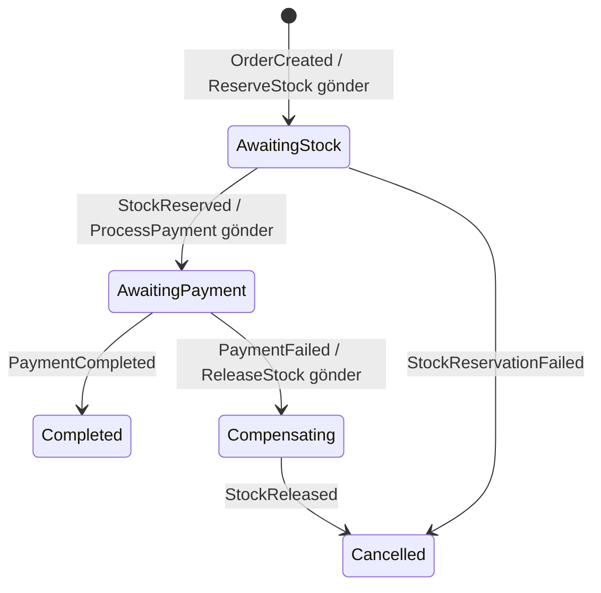
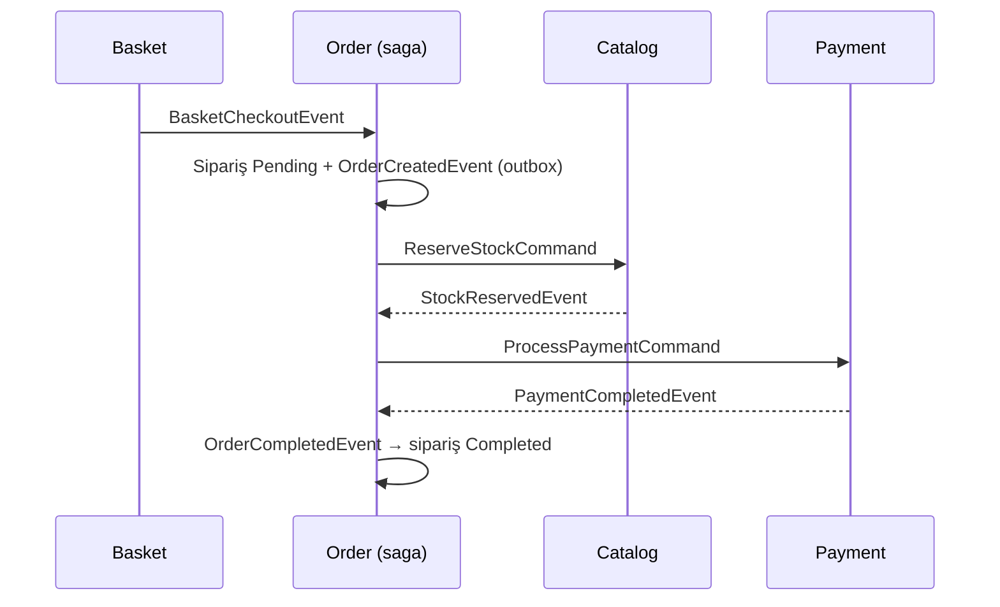
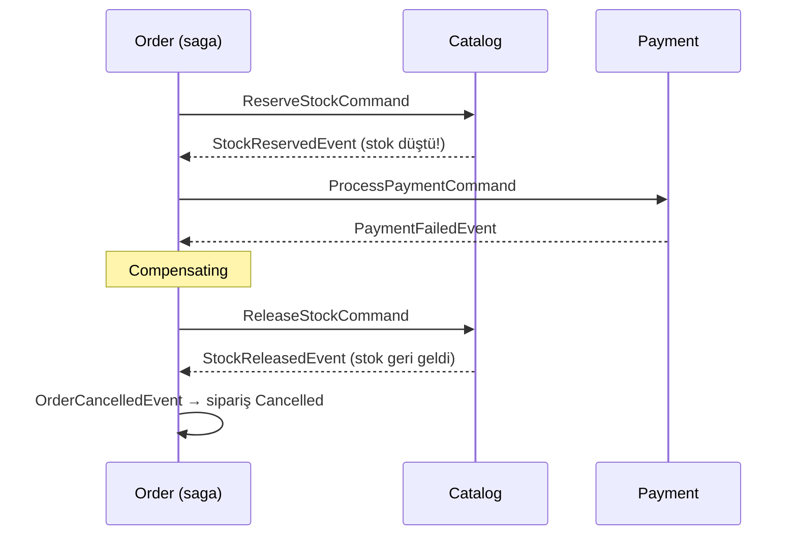
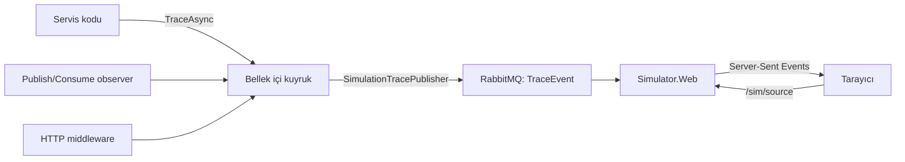

# Saga, telafi ve simülatör

Bu metin [mimari anlatımının](mimari-anlatimi.md) devamıdır. Orada checkout'un bir kuyruğa bırakıldığını ve siparişin arka planda oluştuğunu gördük. Burada o siparişin stok ve ödeme adımlarından nasıl geçtiği, bir adım başarısız olursa neyin nasıl geri alındığı ve bütün bunların simülatörde nasıl izlendiği anlatılır.

## Problem: tek transaction'a sığmayan iş

Bir siparişin tamamlanması için iki şeyin olması gerekir:

1. Catalog'da stok düşmeli (`catalogdb`).
2. Payment'ta ödeme alınmalı.

Monolitte bu tek bir veritabanı transaction'ıdır: biri başarısız olursa `ROLLBACK` ikisini de geri alır. Mikroserviste her servisin kendi veritabanı vardır. Catalog'un commit ettiği stok düşüşünü, Payment'taki bir hata yüzünden geri alacak ortak bir transaction yoktur.

Saga bu boşluğu doldurur: işi her biri kendi servisinde yerel transaction olan adımlara böler. Bir adım başarısız olursa, daha önce başarılı olmuş adımları **telafi eden** yeni adımlar çalıştırır.

## Bu repodaki saga: orkestrasyon

Kararları tek bir yer verir: `Order.Infrastructure/Saga/OrderStateMachine.cs`. MassTransit'in state machine'i her sipariş için `OrderSagaStates` tablosunda bir satır tutar. Bu satır saga'nın hafızasıdır: bir mesaj geldiğinde saga kaldığı yerden devam eder.



| Durum | Ne bekleniyor | Çıkış |
| --- | --- | --- |
| `AwaitingStock` | Catalog'un stok cevabı | `StockReserved` → ödemeye geç; `StockReservationFailed` → iptal |
| `AwaitingPayment` | Payment'ın sonucu | `PaymentCompleted` → tamam; `PaymentFailed` → telafi |
| `Compensating` | Stoğun geri bırakılması | `StockReleased` → iptal |
| `Completed` / `Cancelled` | — | Son durumlar. Satır silinmez ki simülatör ve `GET /orders` sonucu gösterebilsin. |

### Mutlu yol



### Ödeme reddi ve telafi



Telafi bir "rollback" değildir. Stok düşüşü commit edilmiş, belki başka bir sipariş o arada aynı ürünü görmüştür. Telafi, önceki işlemi tersine çeviren **yeni** bir işlemdir. Bu yüzden telafi adımları da tasarlanmalı, test edilmeli ve idempotent olmalıdır.

Stok yetersizse telafi gerekmez. Catalog "ya hepsi ya hiçbiri" kuralıyla çalışır: kalemlerden biri bile yetmiyorsa hiçbirini ayırmaz. Geri alınacak başarılı bir adım olmadığı için saga doğrudan `Cancelled` olur.

### Neden orkestrasyon, koreografi değil?

Koreografide merkez yoktur: Catalog `OrderCreatedEvent`'i dinleyip stok ayırır, Payment `StockReservedEvent`'i dinleyip tahsilat yapar, ve böyle devam eder. Küçük akışlarda daha az kod demektir. Ama sürecin tamamı hiçbir dosyada yazılı değildir; "ödeme reddedilince ne olur?" sorusunun cevabı servislere dağılmıştır.

Bu repo öğretmek için var. Sürecin tamamı tek bir dosyada, okunabilir bir durum makinesi olarak durur. Katılımcılar (Catalog, Payment) saga'dan habersizdir: bir komut alır, bir olay yayınlarlar. Aynı Payment servisi yarın bir abonelik yenileme saga'sında da aynen kullanılabilir.

Koreografiyi denemek istersen iyi bir alıştırma şudur: `OrderStateMachine`'i kapat; Catalog'a `OrderCreatedEvent` consumer'ı, Payment'a `StockReservedEvent` consumer'ı ekle, ve telafiyi Catalog'un `PaymentFailedEvent` dinlemesiyle yap. Simülatörde iki akışı karşılaştır.

## Güvenilir mesajlaşma: outbox, inbox, idempotency

Saga ancak mesajlar kaybolmazsa ve tekrar geldiklerinde zarar vermezse çalışır.

**Transactional outbox.** `BasketCheckoutConsumer` siparişi kaydeder ve `OrderCreatedEvent` yayınlar. Bunlar iki ayrı sistemdir (PostgreSQL ve RabbitMQ). Arada süreç çökerse "sipariş var ama saga hiç başlamadı" durumu oluşur. Outbox açıkken `Publish` mesajı RabbitMQ'ya değil, aynı transaction içindeki `OutboxMessage` tablosuna yazar. Commit sonrasında MassTransit onu iletir. Catalog ve Order bu yüzden `AddEntityFrameworkOutbox` kullanır (`DependencyInjection.cs` dosyaları).

**Inbox.** RabbitMQ "en az bir kez" teslim eder. `InboxState` tablosu aynı mesaj kimliğinin aynı consumer tarafından ikinci kez işlenmesini engeller.

**İş seviyesinde idempotency.** Mesaj kimliği farklı ama anlamı aynı olan tekrarlar için her katılımcı kendi önlemini alır:

| Katılımcı | Tekrar gelirse | Nasıl |
| --- | --- | --- |
| `ReserveStockConsumer` | Stok ikinci kez düşmez | `StockReservations` tablosunda bu sipariş varsa sonucu yeniden yayınlar |
| `ReleaseStockConsumer` | Stok ikinci kez artmaz | Rezervasyon satırları silinmişse sadece olayı yayınlar |
| `ProcessPaymentConsumer` | İkinci kez tahsil etmez | Aynı sipariş için ilk kaydı döndürür |
| `OrderStateMachine` | Hata vermez | `OnUnhandledEvent(x => x.Ignore())` |
| `CustomerOrder` | Durum bozulmaz | `Complete()` / `Cancel()` aynı duruma ikinci geçişte sessiz kalır |

**Eşzamanlılık.** İki sipariş son ürünü aynı anda ayırmaya çalışırsa `Product.Version` (PostgreSQL `xmin`) iyimser kilit gibi çalışır. İkinci yazım `DbUpdateConcurrencyException` alır, `UseMessageRetry` mesajı tekrar dener ve ikinci denemede stok artık yetersizdir. Saga satırı ise `ConcurrencyMode.Pessimistic` ile satır kilidi alır.

**Korelasyon.** Bütün saga mesajları `OrderId` taşır. `Event(() => StockReserved, x => x.CorrelateById(m => m.Message.OrderId))` hangi saga satırının güncelleneceğini söyler.

## Simülatör nasıl çalışır?

Simülatör iş akışının parçası değildir. Servisler "şu an şunu yaptım" bilgisini ayrıca yayınlar; simülatör bunları toplar ve tarayıcıya iter.



Parçalar `Shared.Infrastructure/Simulation` altındadır:

- **`ISimulationTracer`** iş kodunun kullandığı tek arayüzdür. `[CallerFilePath]` ve `[CallerLineNumber]` sayesinde her iz, onu üreten satırı taşır. Arayüzdeki "İzi üreten satır" sekmesi bu sayede açılır.
- **Observer'lar** (`SimulationMessageObservers.cs`) her publish ve consume için otomatik iz üretir. İş koduna dokunmadan bütün mesaj trafiği görünür.
- **HTTP middleware** (`SimulationHttpTraceMiddleware.cs`) isteği geldiğinde ve cevap döndüğünde iki iz üretir. Arayüzün listeleri tazelemek için attığı istekler `X-Simulator-Background` başlığı taşır ve izlenmez. Aksi halde her yenileme yeni bir iz, her iz de yeni bir yenileme üretirdi.
- **Kuyruk ve yayıncı** (`SimulationTracer.cs`): `TraceAsync` izi bellekteki sınırlı bir kuyruğa bırakır ve hemen döner. Arka plandaki `SimulationTracePublisher` izleri sırayla, 3 saniyelik zaman aşımıyla yayınlar. RabbitMQ yavaş ya da kapalı olsa bile HTTP istekleri ve consumer'lar beklemez; en kötü ihtimalle iz kaybolur.
- **`Simulator.Web`**: `TraceEvent`'leri geçici (auto-delete) bir kuyruktan okur, son 1000 izi bellekte tutar ve `/sim/events` üzerinden Server-Sent Events ile yayınlar. `/sim/source` repo'daki kaynak dosyayı döner; yalnızca `src/` altındaki metin dosyalarına izin verilir.

`Simulation:Enabled=false` ayarı izlemeyi tamamen kapatır. Servisler simülatör olmadan da aynen çalışır.

### Arayüz

`http://localhost:5000` adresi gateway üzerinden simülatörü açar.

- **Senaryolar** sepeti doldurur, ödeme ayarını seçer ve checkout yapar. "Ödeme reddi + telafi" senaryosu 4K Monitör stoğunun önce düşüp sonra geri geldiğini gösterir.
- **Adım adım mod** her izi tek tek oynatır (→ tuşu). Detay paneli o adımın açıklamasını, mesaj gövdesini ve ilgili kod satırını gösterir.
- **Diyagramdaki bir kutuya tıklamak** o servisin görevini ve önemli dosyalarını açar.
- **Kavramlar** penceresi bu dokümandaki fikirlerin kısa özetidir.

Arayüzdeki açıklama metinleri ve kod adresleri `src/Web/Simulator.Web/wwwroot/js/knowledge.js` içindedir. Yeni bir mesaj tipi eklediğinde oraya da bir kayıt eklemek, simülatörün o mesajı anlatabilmesini sağlar.

### Kendi izini eklemek

Herhangi bir consumer, endpoint veya state machine adımına:

```csharp
await tracer.TraceAsync(
    "Kargo etiketi oluşturuldu",
    TraceKinds.Database,
    detail: "Shipments tablosuna satır eklendi.",
    orderId: message.OrderId);
```

Satır numarası otomatik gelir; arayüz o satırı işaretler.

## Kendin dene

1. **Kuyruğun dayanıklılığı.** `docker stop payment-api` ile Payment'ı durdur, sonra mutlu yolu çalıştır. Saga `AwaitingPayment` durumunda bekler, `ProcessPaymentCommand` kuyrukta durur (RabbitMQ panelinde `ProcessPayment` kuyruğuna bak). `docker start payment-api` ile servis geri geldiğinde saga kaldığı yerden devam eder.
2. **Yarış.** 4K Monitör stoğunu 1 yap. İki farklı kullanıcıyla neredeyse aynı anda checkout et. Biri `Completed`, diğeri `Cancelled` olmalı.
3. **Banka gecikmesi.** Gecikmeyi 5000 ms yap ve adım adım modda saga'nın `AwaitingPayment` durumunda nasıl beklediğini izle.
4. **Saga zaman aşımı (alıştırma).** Payment hiç cevap vermezse saga sonsuza kadar bekler. MassTransit `Schedule` ile `AwaitingPayment` için 30 saniyelik bir zaman aşımı ekle; süre dolarsa telafiyi başlat.
5. **Testler.** `dotnet test` saga'yı RabbitMQ ve PostgreSQL olmadan, MassTransit test harness'ı ile çalıştırır (`tests/Order.Tests`). Yeni bir durum eklediğinde önce buraya bir test yaz.

## Bilerek bırakılmış sınırlar

- **Saga zaman aşımı yoktur.** Yukarıdaki dördüncü alıştırma budur.
- **Payment kayıtları bellektedir.** Servis yeniden başlarsa ödeme geçmişi silinir. Ödeme son adım olduğu için iade (refund) telafisi gerekmez. Ödemeden sonra bir adım daha eklenirse (ör. kargo), o adımın başarısızlığında `RefundPaymentCommand` gerekir.
- **Basket'te outbox yoktur.** Basket'in veritabanı Redis'tir; yayın ile sepet silme arası atomik değildir. Bu, mimari anlatımında anlatılan sınırdır.
- **Checkout katalog fiyatını doğrulamaz.** İstemcinin gönderdiği fiyat siparişe geçer. Stok kontrolü ise artık Catalog'da yapılır.
- **MassTransit 8.x kullanılır.** 9.x ticari lisans ister. Öğrenme ve şablon amacıyla Apache 2.0 lisanslı 8.x sürümü seçilmiştir.
